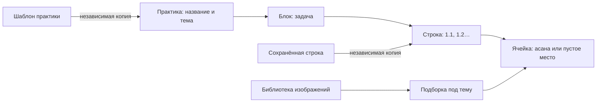

# RibkaYoga: предложение по первой версии

Первоначальное предложение от 28 сентября 2026 года. Приложение уже реализовано и запускается локально в Docker; актуальная поставка описана в `README.md`, правила изменений — в `AGENTS.md`.

Последующие решения владельца имеют приоритет над предложением ниже: категории плоские, без подкатегорий, теги исключены. Формы создания и редактирования карточки содержат одинаковые поля. Редактор использует компактные ячейки, выбор изображения или собственного названия и группы со скобками.

## Идея продукта

Это рабочий инструмент преподавателя и будущего инструктора: библиотека готовых изображений асан и редактор листа практики. Пользователь один раз загружает карточки, затем собирает тренировки из этих карточек, сохраняет удачные строки и использует базовые последовательности как шаблоны.

Главный результат — сохранённый редактируемый лист, который можно открыть позже, скопировать для следующего занятия и распечатать.

Полная инструкция для разработки находится в [IMPLEMENTATION_PROMPT.md](IMPLEMENTATION_PROMPT.md). Её можно целиком передать исполнителю. Здесь объяснены основные продуктовые решения.

## Что видно на примере

На изображении пять блоков с нумерацией строк `1.1`, `1.2`, `1.3`, `2.1` и далее. Значит, нужно сохранять четыре уровня: практика, блок, строка, ячейка. У разных строк разное количество ячеек.



Скобки и специальные символы на примере не трактуем без объяснения преподавателя. В первой версии для таких указаний достаточно заметки к строке и подписи к отдельной асане. Автоматическую расшифровку листа не включаем.

## Два раздела и три рабочих экрана

| Экран | Что на нём делать |
| --- | --- |
| Библиотека | Загружать карточки, редактировать названия, искать, фильтровать по категориям и собирать подборки |
| Практики | Находить сохранённые листы, создавать новые, копировать старые, выбирать шаблоны и сохранённые строки |
| Редактор практики | Заполнять строки, менять асаны, переставлять блоки, сохранять и готовить лист к печати |

В навигации остаются только «Практики» и «Библиотека». Редактор открывается из списка практик. Подборки находятся вкладкой внутри библиотеки; шаблоны и сохранённые строки — вкладками внутри раздела практик.

На широком экране редактор выглядит так:

```text
RibkaYoga       Практики   Библиотека                     Профиль
← Практики      Мобильность плеч       Сохранено    Просмотр  Печать
Тема: подготовка к выбранной задаче
┌─────────────────────────────────────┬──────────────────────────┐
│ 1. Мобильность                 ⋯    │ Подборки | Все асаны     │
│ 1.1  [асана] [асана] [  +  ] [  +  ]│ [Мобильность плеч    ▾]  │
│      Ячеек: − 4 +             ⋯    │ [Поиск по названию     ] │
│ 1.2  [асана] [  +  ] [  +  ]        │                          │
│      + Добавить строку              │ [карточка] [карточка]    │
│                                     │ [карточка] [карточка]    │
│ 2. Специализация               ⋯    │                          │
│ 2.1  [  +  ] [  +  ] [  +  ]        │ Выберите ячейку и асану  │
└─────────────────────────────────────┴──────────────────────────┘
```

На телефоне выбор карточек открывается снизу. Основной сценарий: нажать ячейку, затем нужную асану. Перетаскивание остаётся удобным дополнением для компьютера.

## Как проходит работа

1. Загрузить отдельные изображения пачкой. Названия файлов используются как черновые названия, затем их можно поправить.
2. Разложить карточки по категориям и подкатегориям. Например: «Положение тела → Стоя». Произвольные теги позволяют дополнительно отметить тему или назначение.
3. Выделить несколько асан и сохранить подборку: «Мобильность плеч», «Для занятия в понедельник».
4. Создать практику с пятью блоками или скопировать свою базовую последовательность.
5. Настроить строки и количество ячеек; переносить карточки из боковой панели или вставлять нажатием.
6. Сохранить полезную строку для будущего использования. При необходимости сохранить всю практику как шаблон.
7. Открыть чистый лист и напечатать его либо выбрать «Сохранить как PDF» в диалоге печати браузера.

## Что такое «облако асан»

В интерфейсе лучше назвать его «Подборка». Это сохранённый вручную выбранный набор карточек. Одна асана может входить в несколько подборок и многократно использоваться в одной практике.

Категория описывает место асаны в библиотеке; подборка помогает подготовиться к конкретной работе. Подборка не ограничивает доступные в блоке асаны. В MVP её выбирают вручную в боковой панели, а последняя выбранная подборка запоминается для пользователя и практики.

## Что включить в MVP

- Два отдельных аккаунта в общем рабочем пространстве: автор и преподаватель. Вход по email и паролю. Создание первых аккаунтов и доступа — через служебную команду, без публичной регистрации.
- Пакетная загрузка PNG, JPEG и WebP; просмотр и редактирование карточек.
- Названия, альтернативные названия, категории с подкатегориями, теги, поиск и сортировка по русскому алфавиту.
- Именованные подборки и быстрый переход из подборки к созданию практики.
- Редактор блоков, строк и ячеек; стартовые пять блоков; в интерфейсе 1–12 ячеек на строку, лимит задаётся конфигурацией.
- Вставка, замена и перенос асан, очистка ячейки, копирование строки и блока, отмена и повтор действий.
- Автосохранение, ручное сохранение, сообщения об ошибке и защита от незаметной перезаписи из другой вкладки.
- Сохранённые строки, шаблоны практик, дублирование практики.
- Чистый просмотр и печать A4, включая сохранение PDF средствами браузера.

## Решения, которые сохранят данные

Шаблоны вставляются как независимые копии. Изменение базовой последовательности не перестраивает старые занятия. Ячейка хранит название на момент вставки и ссылку на конкретный файл изображения. Если в каталоге исправили название или заменили картинку, уже собранный лист останется прежним.

Асаны убираются в архив. Изображения, используемые сохранёнными практиками и шаблонами, сохраняются. При уменьшении строки пользователь заранее видит, сколько заполненных ячеек будет удалено.

Совместная работа в первой версии означает общий доступ к сохранённым данным. Если два человека редактируют один лист, система обнаруживает конфликт версий и предлагает сохранить локальный вариант отдельной практикой или загрузить актуальную версию.

## Внешний вид

Белый лист и светлый фон, тонкие серые границы, тёмный читаемый текст, округлые кнопки и спокойный зелёный акцент. От приложений вроде Duolingo здесь полезны понятные состояния кнопок, крупные зоны нажатия и дружелюбная обратная связь.

Карточки асан остаются главными визуальными элементами. Изображения не обрезаются и не растягиваются. На листе для печати исчезают элементы редактора; остаются название, тема, номера строк, изображения и подписи.

## Техническое устройство

Предлагается Laravel 13, PHP 8.3 или новее в поддерживаемом диапазоне, Vue 3, TypeScript, Inertia, Vite, Tailwind и PostgreSQL. Конкретные совместимые версии нужно зафиксировать lock-файлами при реализации. Laravel 13 требует PHP 8.3; официальный Vue starter kit уже соединяет Vue, TypeScript и Inertia с Laravel. [Требования Laravel](https://laravel.com/framework/docs/releases), [официальный starter kit](https://laravel.com/framework/docs/starter-kits).

Архитектура — модульный монолит: один Laravel-проект и одна база, внутри которых пять модулей:

| Модуль | Ответственность |
| --- | --- |
| Access | Пользователи, рабочие пространства и доступ |
| Media | Файлы изображений, загрузка и защищённая выдача |
| Catalog | Асаны, названия, категории, теги и поиск |
| Collections | Именованные подборки и их состав |
| Practices | Практики, строки, ячейки, шаблоны, сохранение и печать |

Модули общаются через небольшие контракты внутри приложения. Они владеют своими таблицами и не изменяют чужие данные напрямую. Это позволяет развивать отдельные части, сохраняя простой запуск приложения. Реальное выделение модуля в отдельный сервис, если оно когда-нибудь понадобится, останется отдельной инженерной задачей.

Шаблоны и печать пока входят в Practices: они работают с той же структурой последовательности и не требуют отдельных сервисов. Redis, брокеры сообщений, отдельный API-сервер и сложная инфраструктура для первой версии не нужны.

## Этапы реализации

| Этап | Результат, который можно показать |
| --- | --- |
| 1. Основа | Запускающееся приложение, вход двух пользователей, общий доступ, базовый белый интерфейс |
| 2. Библиотека | Загрузка настоящих карточек, поиск, категории, подборки |
| 3. Конструктор | Пять стартовых блоков, разные строки, вставка и перенос карточек, сохранение |
| 4. Повторное использование | Сохранённые строки, базовые шаблоны, независимые копии |
| 5. Готовый лист | Просмотр, печать, адаптация телефона, ручная проверка полного сценария |

Все пять этапов входят в предложенный MVP. Без конструктора, сохранения и печати задачу нельзя считать выполненной.

Автоматические тесты по требованию владельца не пишем. Правило закреплено в корневом `AGENTS.md`. Проверяем сборку, типы, маршруты, миграции и реальные действия в браузере по описанным в полном промпте сценариям.

## Развитие после первой версии

Следующий отдельный модуль Learning сможет хранить задания, ответы учеников, комментарии преподавателя и статусы проверки. Он будет ссылаться на сохранённые версии практик через контракт Practices. Доступ ученика к заданию потребуется проверять отдельно; общего членства в рабочем пространстве для этого недостаточно.

Позже можно добавить сохранённые блоки, диапазоны повторов со скобками, историю версий, обмен шаблонами, серверную выгрузку PDF/PNG и платные планы. До уточнения методики не реализуем автоматическую оценку правильности или безопасности практики.

## Принятые допущения

- Предоставят отдельные файлы карточек. Вырезание всех фигур из фотографии и распознавание рукописей — отдельная задача.
- Названия и тематику асан вводят автор и преподаватель. Система сама не определяет медицинское или методическое назначение позы.
- Начальный продукт рассчитан на небольшой общий каталог и двух пользователей.
- Основное составление — с компьютера или планшета, телефон поддерживает просмотр и редактирование нажатием.
- Пять блоков, шесть стартовых ячеек и предел 12 ячеек — предлагаемые настройки первой версии, которые можно изменить.
- Точное воспроизведение нечитаемых асан и специальных знаков со скриншота не требуется. Повторяем структуру листа и работаем с оригинальными карточками пользователя.
